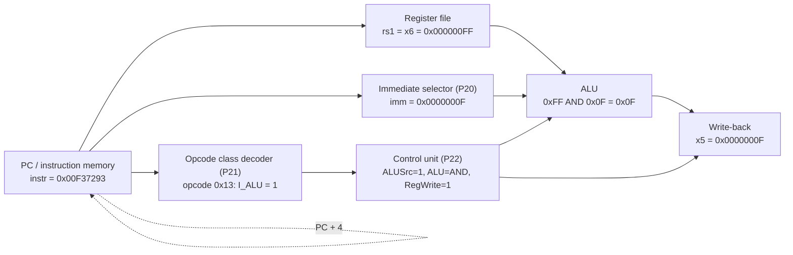

# P21 Opcode class decoder: dossier

Part of the **RC-V** processor project. The block reads the 7-bit opcode of an RV32I instruction and raises exactly one *class* line for the control unit.

**Neighbouring blocks:** P20 Immediate selector · P22 Hardwired control unit

## Contents

- [U1 Digital logic](#u1-digital-logic)
- [U2 Digital components](#u2-digital-components)
- [U3 Data representation](#u3-data-representation)
- [U4 Computer organisation](#u4-computer-organisation)
- [U5 Processors](#u5-processors)
- [U6 Memory and I/O](#u6-memory-and-io)
- [E1 Instruction trace: ANDI](#e1-instruction-trace-andi)
- [E2 Neighbour review](#e2-neighbour-review)
- [E3 Where my block sits](#e3-where-my-block-sits)
- [E4 Syllabus map](#e4-syllabus-map)

---

## U1 Digital logic

**Truth table** (part of it; every other 7-bit input gives all class lines `0`):

| Opcode `o6..o0` | Hex  | Class line             |
|-----------------|------|------------------------|
| `0110011`       | 0x33 | R-type (ADD, AND, ...) |
| `0010011`       | 0x13 | I-type ALU (ADDI, ANDI, ...) |
| `0000011`       | 0x03 | Load                   |
| `0100011`       | 0x23 | Store                  |
| `1100011`       | 0x63 | Branch                 |
| `1101111`       | 0x6F | JAL                    |
| `1100111`       | 0x67 | JALR                   |
| `0110111`       | 0x37 | LUI                    |
| `0010111`       | 0x17 | AUIPC                  |

**Boolean expressions** (`!` = NOT, `&` = AND). Every valid 32-bit opcode ends in `11`, so `o1 & o0` is a shared term:

```text
R_TYPE  = !o6 &  o5 &  o4 & !o3 & !o2 & o1 & o0
I_ALU   = !o6 & !o5 &  o4 & !o3 & !o2 & o1 & o0
LOAD    = !o6 & !o5 & !o4 & !o3 & !o2 & o1 & o0
STORE   = !o6 &  o5 & !o4 & !o3 & !o2 & o1 & o0
BRANCH  =  o6 &  o5 & !o4 & !o3 & !o2 & o1 & o0
```

Each line is a single AND of the 7 (possibly inverted) opcode bits, so a K-map gives nothing more than sharing the inverters and the `o1 & o0` term.

**Gates needed:** NOT and AND (plus an OR where a line merges classes, e.g. "uses immediate"). The block is purely combinational: **no flip-flops**.

## U2 Digital components

- **Splitter** to break the instruction/opcode bus into single bits.
- **NOT gates** for the inverted bits.
- **AND gates**, one per class.
- *Alternative:* a decoder on `opcode[6:2]` (5 bits, 32 outputs) whose outputs are ANDed with `o1 & o0`; the valid classes are picked from its outputs.

No adders, registers or memory are inside the block. Its input comes from the instruction register / instruction memory output, and its class lines go to the control logic.

## U3 Data representation

The input is a 7-bit **unsigned** opcode, so signedness does not apply to it.

| Binary    | Hex  | Decimal | Result            |
|-----------|------|---------|-------------------|
| `0110011` | 0x33 | 51      | R-type line = 1   |
| `0010011` | 0x13 | 19      | I-ALU line = 1 (the ANDI class) |
| `0100011` | 0x23 | 35      | Store line = 1    |

**What could go wrong.** The decoder has no arithmetic, so it cannot overflow itself. The risks are around it:

- The opcode must come from bits `[6:0]` of the instruction, not shifted by one.
- The low two bits `11` must be checked; otherwise 16-bit (compressed) or invalid words decode as valid.
- The signed immediate of I-type, Store and Branch instructions must be **sign-extended from bit 31**. For example, ANDI with `imm = 0xFFF` is -1 and must become `0xFFFFFFFF`, not `0x00000FFF`. The immediate selector (P20) does this, and my class line tells it which format to use.

## U4 Computer organisation

The block works in the **decode** step of the instruction cycle: once fetch has put the instruction in the instruction register, the decoder turns the opcode into a class that the control unit uses to drive execute, memory and write-back.

**Every instruction needs it**, since each must be classified:

| Class  | Example instructions |
|--------|----------------------|
| R-type | ADD, AND             |
| I-ALU  | ADDI, ANDI           |
| Load   | LW                   |
| Store  | SW                   |
| Branch | BEQ                  |

## U5 Processors

- **CISC (e.g. x86):** variable-length instructions and many formats make decoding much harder; a microcode ROM usually expands one instruction into several micro-operations, instead of a single small AND plane like mine.
- **Stack machine:** opcodes carry few or no operand fields (operands are implicit on the stack), so decoding is simpler, with no register numbers to decode.
- **GPU:** one decode serves a whole group of threads (SIMT), so the cost is shared; instructions are wide and use per-thread masking.
- **Mano basic computer vs RC-V:** Mano uses a 3-bit opcode (plus the I bit) in a 16-bit instruction, decoded by a 3-to-8 decoder (D0-D7). RC-V decodes a 7-bit opcode in a fixed-length 32-bit instruction with separate fields for registers and `funct3`/`funct7`, which is more regular and can be decoded in parallel with the register read.

## U6 Memory and I/O

The decoder does **not** touch memory or I/O itself; it only marks Load and Store instructions.

1. My Load/Store class line goes to the control unit (P22).
2. The control unit asserts `MemRead` / `MemWrite`.
3. The ALU computes the address (`rs1 + immediate`).
4. The data memory performs the access.

I/O is memory-mapped in RISC-V, so an I/O transfer is just a load or store to a special address and starts the same way.

## E1 Instruction trace: ANDI

Example: `ANDI x5, x6, 0x0F` with `x6 = 0x000000FF` and `PC = 0x00000000`.

> These are example values. Check them against the simulator's `--trace` output and adjust if yours differ.

**Encoding:**

| Field        | `imm[11:0]`    | `rs1`   | `funct3` | `rd`    | `opcode`  |
|--------------|----------------|---------|----------|---------|-----------|
| Binary       | `000000001111` | `00110` | `111`    | `00101` | `0010011` |

Together: `0x00F37293`.



| Block                            | Main signals |
|----------------------------------|--------------|
| PC / instruction memory (fetch)  | `PC = 0x00000000`, `instruction = 0x00F37293` |
| **Opcode class decoder (P21)**   | `opcode = 0x13` (`0010011`), `I_ALU = 1`, all other class lines `0` |
| Immediate selector (P20)         | I-format: `imm = sign_extend(0x00F) = 0x0000000F` |
| Register file                    | `rs1 = x6 -> 0x000000FF`, `rd = x5` |
| Control unit (P22)               | `ALUSrc = 1`, ALU op = AND (`funct3 = 111`), `RegWrite = 1`, `MemRead = 0`, `MemWrite = 0`, `MemtoReg = 0`, `Branch = 0` |
| ALU                              | `0x000000FF & 0x0000000F = 0x0000000F` |
| Data memory                      | not accessed |
| Write-back                       | `x5 <- 0x0000000F` |
| PC update                        | `PC <- PC + 4 = 0x00000004` |

## E2 Neighbour review

Review comments on the pull requests of P20 (Immediate selector) and P22 (Hardwired control unit):

- P20 (Immediate selector):
- P22 (Hardwired control unit):

## E3 Where my block sits

My block is in the **control** layer, at the start of decoding: it is built from simple gates, but its job is to classify instructions. It is fed by the instruction register / instruction memory (opcode bits `[6:0]`). Its class lines are used by the hardwired control unit (P22) to produce the datapath control signals, and by the immediate selector (P20) to choose the immediate format.

## E4 Syllabus map

- [x] Logic gates, Boolean algebra, K-maps
- [x] Combinational circuits (adders, decoders, encoders, multiplexers)
- [ ] Flip-flops, registers, counters
- [ ] Memory (RAM, ROM)
- [x] Number systems, complements, signed arithmetic
- [x] Bus organisation, instruction codes and formats
- [x] Instruction cycle, hardwired vs microprogrammed control
- [ ] Interrupts and the interrupt cycle
- [ ] Pipelining
- [ ] Register organisation, stack, addressing modes
- [x] RISC vs CISC, multicore, GPU
- [ ] Memory hierarchy, cache
- [ ] I/O interface, programmed / interrupt-driven I/O, DMA
